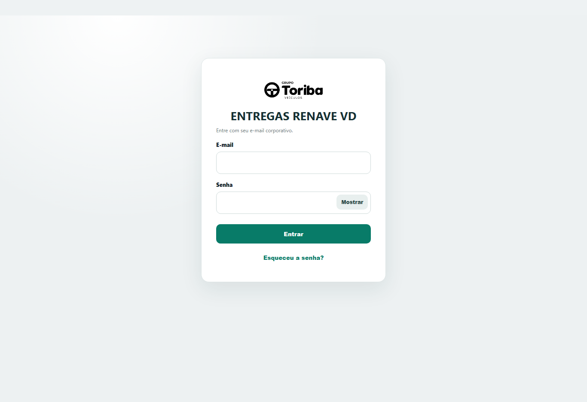
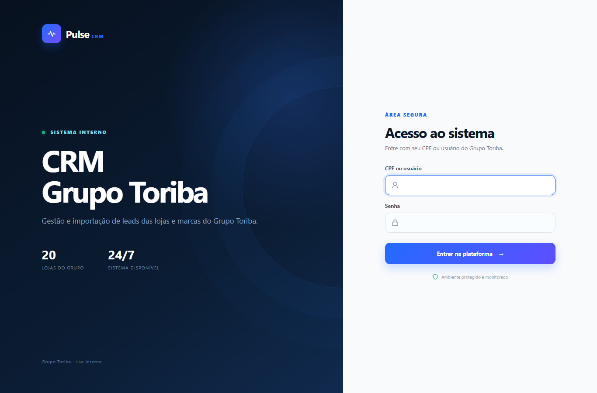
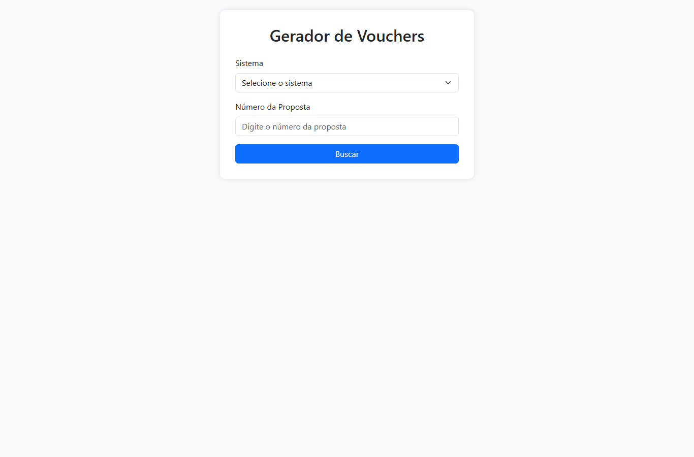

# Olá, sou o Gabriel Saraiva 👋

Desenvolvedor no **Grupo Toriba**, grupo de concessionárias de veículos com mais de 20 lojas. Construo os sistemas internos e as automações do grupo: aplicações web, integrações com APIs do governo, de bancos e de CRM, e robôs que eliminam trabalho manual nas áreas fiscal, comercial, financeira e de RH.

Cuido do ciclo completo: levantamento com a área, desenvolvimento, publicação no servidor, monitoramento e documentação.

**Stack principal:** Node.js · TypeScript · Python · Django · Flask · React · SQL Server · Oracle · Playwright · Nginx · Windows Server

---

## 🖥️ Aplicações web

### Conciliação Fiscal de NF-e
Busca os XMLs das notas recebidas na API da Qive e compara item a item com o que foi lançado no ERP: CFOP, CST/CSOSN, NCM, bases e alíquotas de ICMS/ICMS-ST, quantidades e valores. As divergências saem em Excel para a equipe fiscal.
- Separação automática entre notas de **peças, veículos e consumo**, com pareamento de veículos pelo chassi
- Cadastros de DE-PARA (CFOP e CST/CSOSN) editáveis pela própria equipe fiscal
- Relatório consolidado das notas sem entrada no ERP, para todas as empresas do grupo
- Roda como serviço no Windows atrás do Nginx, com health check e recuperação automática

`Node.js` `Express` `SQL Server` `ExcelJS` `fast-xml-parser` `Nginx`

### Entrega RENAVE e ATPV-e
Consulta a entrega de veículos zero km pelo chassi na API do RENAVE (SERPRO), registra a entrega e baixa o ATPV-e em PDF.
- Autenticação **mTLS** com certificado digital, mantido somente no backend
- Histórico e reimpressão do ATPV-e a partir do banco, sem nova chamada ao SERPRO
- Modo simulado para testar o fluxo sem acesso à API real

`Node.js` `mTLS` `SQL Server`

### CRM de Leads
Plataforma que substituiu um script desktop: os usuários enviam planilhas de leads de montadoras e portais, que são validadas e enviadas para o CRM Syonet via API, agora para **todas as lojas e marcas** do grupo.
- Perfis de administrador e operador, com lojas liberadas por usuário
- Processamento em segundo plano com barra de progresso e novas tentativas automáticas
- Credenciais fora do código, em variáveis de ambiente

`Django` `Python` `pandas` `SQLite` `Waitress`

### Gerador de Vouchers de Revisão
Busca a proposta de venda no ERP (DealerNet ou NBS) e gera o voucher de revisão do cliente em PDF.

`Flask` `SQL Server` `Oracle` `PyPDF`

### Auditorias SSMA
Sistema de auditorias de Saúde, Segurança e Meio Ambiente, com registro padronizado de desvios, ações e evidências e assinatura do fiscal.

`React` `Vite` `Node.js` `Express` `JWT` `SQL Server`

### Reserva de Salas
Agenda compartilhada para as cinco salas da empresa, publicada com HTTPS.
- Reservas recorrentes de até 90 dias com bloqueio de sobreposição no banco: um conflito cancela a criação inteira
- Senhas com PBKDF2-SHA256, sessões com cookies `Secure`/`HttpOnly`/`SameSite=Strict` e limite de tentativas de login
- Exportação para calendário (`.ics`), modo escuro e layout responsivo
- 13 testes de integração, incluindo conflitos simultâneos

`Cloudflare D1` `Node.js` `Drizzle`

### Hub de Projetos
Site que apresenta o portfólio digital do grupo, com uma escultura 3D de pontos em Canvas que reage ao scroll e ao ponteiro e uma comparação animada do tempo de cada processo antes e depois da automação.
- Desenho em Canvas otimizado de **14,7 ms para cerca de 1,9 ms** por quadro
- Respeita a preferência de movimento reduzido e pausa as animações fora da tela

`HTML` `CSS` `JavaScript` `Canvas`

---

## ⚙️ Automações

| Automação | O que faz | Tecnologias |
|---|---|---|
| **Planilha de Estoque** | Robô de navegador baixa os relatórios do DealerNet, cruza com Oracle e SQL Server, atualiza a planilha de estoque e envia por e-mail | TypeScript, Playwright, ExcelJS |
| **Análise de Risco** | Aplicativo desktop que consulta o ERP e gera a análise de risco de pessoa física em documento | Python, Tkinter, Oracle, PyInstaller |
| **Checklist de Entrega** | Gera o checklist de entrega do veículo em PDF a partir de templates Word | Python, docxtpl, Oracle |
| **Integração bancária** | Consulta saldo e extrato pela API do banco com certificado digital | Python |
| **Relatórios agendados** | Limite de crédito, formas de pagamento por proposta, peças e outros relatórios enviados automaticamente por e-mail | Python, pandas, SQL Server, Oracle, SMTP |
| **Cancelamento de NF em lote** | Processa cancelamentos de notas fiscais com log de cada execução | Python, pyodbc, SQL Server |

---

## 🛠️ Infraestrutura e operação

- Publicação das aplicações no Windows Server como serviços (NSSM e Agendador de Tarefas), atrás do Nginx
- Painel de operação, scripts de validação dos sistemas e rotina de backup automatizada
- Segredos centralizados fora dos projetos, nunca no código-fonte
- Documentação técnica e manual de cada automação

---

> Sistemas desenvolvidos para uso interno do Grupo Toriba. O código-fonte e os dados pertencem à empresa e não são públicos.

📫 **Contato:** gabrielsaraivabr@gmail.com
