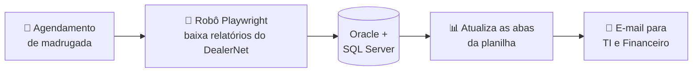
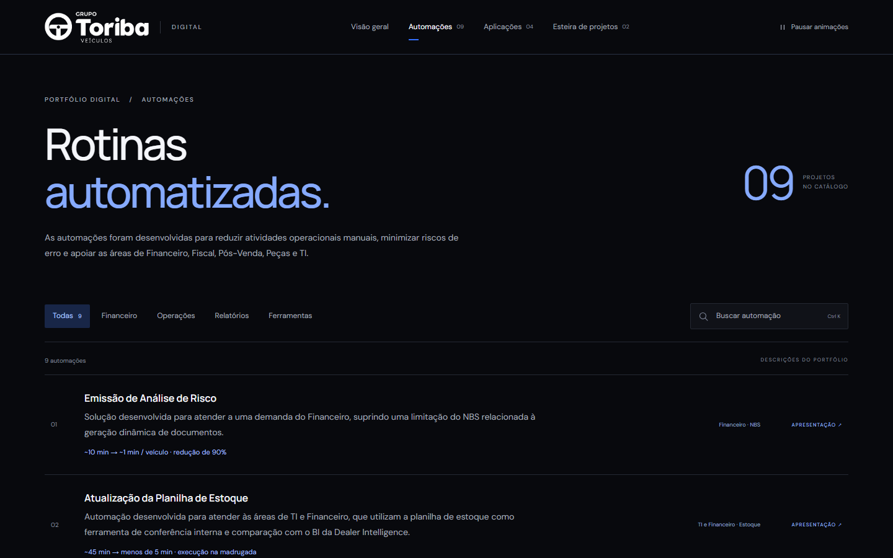
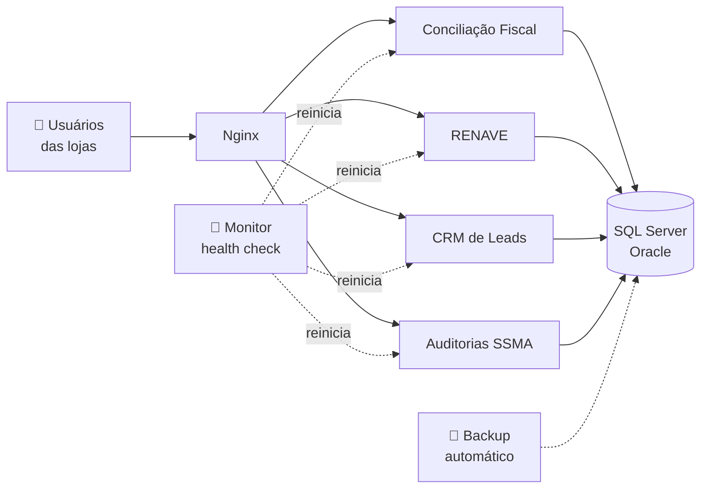

# Gabriel Saraiva

**Desenvolvedor de sistemas e automações · Grupo Toriba**

Transformo processos manuais de um grupo de concessionárias com mais de 20 lojas em sistemas web, integrações e robôs que trabalham sozinhos.

---

## 📊 Impacto em números

<table>
<tr>
<td align="center" width="25%"><h2>-90%</h2>tempo na análise de risco 10 min → 1 min por veículo</td>
<td align="center" width="25%"><h2>-95%</h2>tempo no checklist de entrega 5 min → 15 s por veículo</td>
<td align="center" width="25%"><h2>45 → &lt;5 min</h2>planilha de estoque pronta antes do expediente</td>
<td align="center" width="25%"><h2>400+</h2>veículos de frota por semana tratados sem trabalho manual</td>
</tr>
</table>

**9 automações** e **6 aplicações web** em produção, atendendo as áreas Financeira, Fiscal, Comercial, Pós-venda, Peças, TI e RH.

---

## ⚙️ Automações

### Antes e depois

<table>
<tr>
<td width="33%"></td>
<td width="33%"></td>
<td width="33%"></td>
</tr>
<tr>
<td align="center"><b>Planilha de Estoque</b></td>
<td align="center"><b>Análise de Risco</b></td>
<td align="center"><b>Checklist de Entrega</b></td>
</tr>
</table>

### 📦 Atualização da Planilha de Estoque
> **~45 min manuais → menos de 5 min, de madrugada, sem ninguém.**

A planilha que TI e Financeiro usam para conferir o estoque com o BI da Dealer Intelligence era montada à mão todo dia. Agora um robô entra no DealerNet sozinho, baixa os relatórios de estoque, propostas, pedidos e títulos a pagar, cruza com Oracle e SQL Server, atualiza todas as abas e manda a planilha por e-mail. Quando a equipe chega, ela já está pronta.

`TypeScript` `Playwright` `ExcelJS` `Oracle` `SQL Server` `SMTP`

### 📄 Emissão de Análise de Risco
> **~10 min → ~1 min por veículo faturado. Redução de 90%.**

O Financeiro precisava de um documento de análise de risco que o ERP NBS não conseguia gerar de forma dinâmica. Desenvolvi um aplicativo desktop que consulta os dados do veículo e do cliente no ERP e gera o documento pronto a partir de um template Word.

`Python` `Tkinter` `Oracle` `docx` `PyInstaller`

### ✅ Checklist de Entrega de Veículos
> **~5 min → ~15 s por veículo. Redução de 95%.**

Mesma limitação do NBS, outro documento: o checklist de entrega era preenchido à mão para cada veículo faturado. A automação busca as informações no sistema e gera o checklist em PDF em segundos.

`Python` `Oracle` `docxtpl` `docx2pdf`

### 🚗 Remoção de Entradas de Frota
> **Mais de 400 veículos por semana.**

Veículos de frota chegam junto com os arquivos de faturamento da montadora e entram automaticamente no DealerNet, mas precisam ser removidos depois. A automação identifica essas entradas e faz a exclusão em lote, com log de cada execução.

`Python` `pandas` `pyodbc` `SQL Server`

### 🎟️ Emissão de Vouchers de Revisão
Criada para um evento de pós-venda: a equipe digita o número da proposta e o sistema busca os dados no ERP (DealerNet ou NBS) e gera o voucher de revisão do cliente em PDF, sem preenchimento manual durante o atendimento.

`Flask` `SQL Server` `Oracle` `PyPDF`

### 📬 Relatórios automáticos

| Relatório | Para quem | Frequência |
|---|---|---|
| Faturamento do Pós-venda (Renault e VW) | Integração com o sistema de comércio | Diário |
| Faturamento de Peças (Peugeot e Citroën) | Integração com o sistema de comércio | Diário |
| Limites de Crédito dos clientes | Financeiro | Quinzenal |
| Recebimentos por Proposta de venda | Financeiro | Sob demanda |

Todos consultam o ERP, consolidam os dados, geram a planilha e enviam por e-mail, sem extração manual.

`Python` `pandas` `SQL Server` `Oracle` `SMTP`

<b>🖼️ Ver o catálogo de automações no Hub</b>

 

---

## 🖥️ Aplicações web

### 🧾 Conciliação Fiscal de NF-e
Busca os XMLs das notas recebidas pelos CNPJs do grupo na API da Qive e compara **item a item** com o que foi lançado no ERP: CFOP, CST/CSOSN, NCM, bases e alíquotas de ICMS e ICMS-ST, quantidades e valores. As divergências saem em Excel para a equipe fiscal.

- Classificação automática entre notas de **peças, veículos e consumo**, com pareamento de veículos pelo chassi
- Cadastros de DE-PARA de CFOP e CST/CSOSN editáveis pela própria equipe fiscal
- Relatório consolidado das notas sem entrada no ERP para todas as empresas do grupo
- Roda como serviço no Windows atrás do Nginx, com health check e recuperação automática

`Node.js` `Express` `SQL Server` `ExcelJS` `fast-xml-parser` `Nginx`

### 🚘 Entrega RENAVE e ATPV-e
Consulta a entrega de veículos zero km pelo chassi na API do RENAVE (SERPRO), registra a entrega e baixa o ATPV-e em PDF.

- Autenticação **mTLS** com certificado digital, mantido somente no backend
- Histórico e reimpressão do ATPV-e direto do banco, sem nova chamada ao SERPRO
- Modo simulado para testar o fluxo inteiro sem a API real

`Node.js` `mTLS` `SQL Server`

### 📇 CRM de Leads
Substituiu um script desktop: os usuários enviam planilhas de leads de montadoras e portais, que são validadas e enviadas ao CRM Syonet via API, agora para **as 20 lojas e todas as marcas** do grupo.

- Perfis de administrador e operador, com lojas liberadas por usuário
- Processamento em segundo plano com barra de progresso e novas tentativas automáticas
- Credenciais fora do código, em variáveis de ambiente

`Django` `Python` `pandas` `SQLite` `Waitress`

<table>
<tr>
<td width="50%"></td>
<td width="50%"></td>
</tr>
<tr>
<td align="center"><b>Entrega RENAVE</b></td>
<td align="center"><b>CRM de Leads</b></td>
</tr>
</table>

### 🦺 Auditorias SSMA
Registro padronizado de desvios, ações e evidências em auditorias de Saúde, Segurança e Meio Ambiente, com assinatura do fiscal.

`React` `Vite` `Node.js` `Express` `JWT` `SQL Server`

### 📅 Reserva de Salas
Agenda compartilhada das cinco salas da empresa, publicada com HTTPS.

- Reservas recorrentes de até 90 dias com bloqueio de sobreposição no banco: um conflito cancela a criação inteira
- Senhas com PBKDF2-SHA256, cookies `Secure`/`HttpOnly`/`SameSite=Strict` e limite de tentativas de login
- Exportação para calendário (`.ics`), modo escuro e layout responsivo
- 13 testes de integração, incluindo conflitos simultâneos

`Cloudflare D1` `Node.js` `Drizzle`

### ✨ Hub de Projetos
O site da capa deste portfólio: apresenta o portfólio digital do grupo, com uma escultura 3D de pontos em Canvas que reage ao scroll e ao ponteiro e a comparação animada de tempo de cada processo.

- Desenho em Canvas otimizado de **14,7 ms para cerca de 1,9 ms** por quadro
- Respeita a preferência de movimento reduzido e pausa as animações fora da tela

`HTML` `CSS` `JavaScript` `Canvas`

---

## 🛠️ Infraestrutura e operação

- Aplicações publicadas no Windows Server como serviços (NSSM e Agendador de Tarefas), atrás do Nginx
- Health check com recuperação automática, painel de operação e scripts de validação
- Backup automatizado dos bancos
- Segredos centralizados fora dos projetos, nunca no código-fonte
- Documentação técnica e manual de cada sistema

---

Sistemas desenvolvidos para uso interno do Grupo Toriba. O código-fonte e os dados pertencem à empresa e não são públicos.

📫 **gabrielsaraivabr@gmail.com**

