

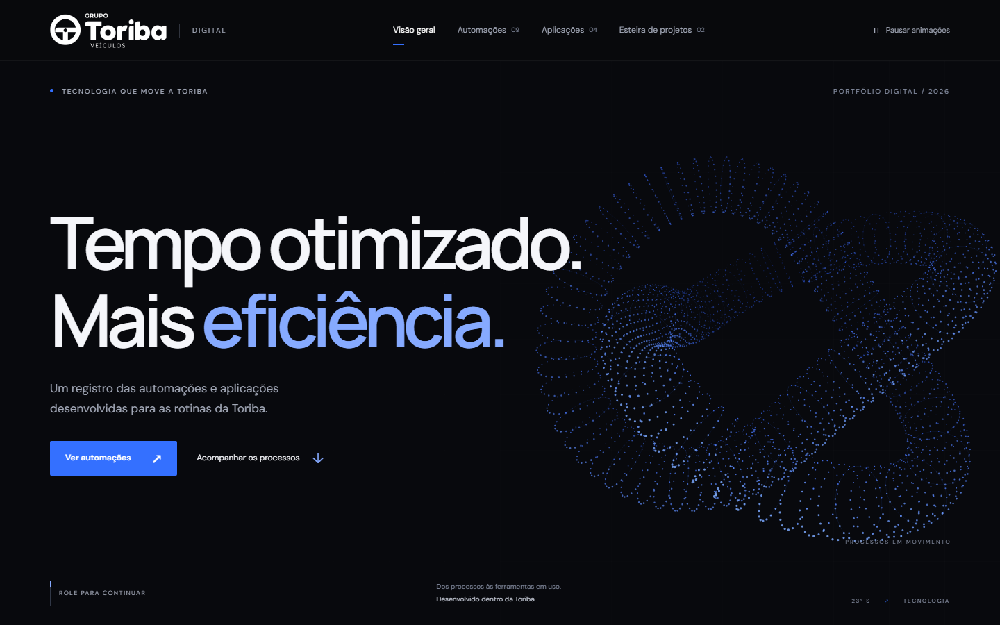

# Gabriel Saraiva

**Desenvolvedor de sistemas e automações · Grupo Toriba**

Transformo processos manuais de um grupo de concessionárias com mais de 20 lojas em sistemas web, integrações e robôs que trabalham sozinhos.

---

## 📊 Impacto em números

<table>
<tr>
<td align="center" width="33%">
<h1>45 → &lt;5 min</h1>
<b>Planilha de Estoque</b> 
atualizada sozinha todo dia às 05h40, pronta antes do expediente
</td>
<td align="center" width="33%">
<h1>100% digital</h1>
<b>Auditorias SSMA Unipetro</b> 
do formulário em papel ao fluxo com assinatura digital, gráficos e relatórios
</td>
<td align="center" width="33%">
<h1>1 → 20 lojas</h1>
<b>Pulse CRM</b> 
leads de todas as lojas e marcas do grupo chegando ao CRM com rastreio lead a lead
</td>
</tr>
<tr>
<td align="center">
<h1>-90%</h1>
<b>Análise de Risco</b> 
10 min → 1 min por veículo faturado
</td>
<td align="center">
<h1>-95%</h1>
<b>Checklist de Entrega</b> 
5 min → 15 s por veículo faturado
</td>
<td align="center">
<h1>400+</h1>
<b>veículos de frota por semana</b> 
tratados sem trabalho manual
</td>
</tr>
</table>

<b>8 automações</b> e <b>5 aplicações web</b> em produção · Financeiro · Fiscal · Comercial · Pós-venda · Peças · TI · RH · SSMA

---

## ⭐ Projetos em destaque

### 📦 Automação da Planilha de Estoque

> **De ~45 minutos de trabalho manual para menos de 5 minutos, de madrugada, sem ninguém.**

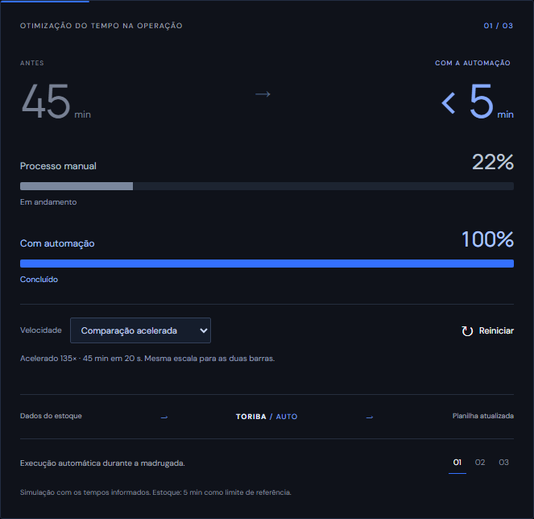

TI e Financeiro usam a planilha de estoque todo dia para conferir os números com o BI da Dealer Intelligence. Antes, alguém precisava entrar no DealerNet, baixar relatório por relatório, rodar consultas e colar tudo nas abas certas, todo dia.

Hoje, às **05h40**, um robô faz tudo sozinho:

1. Abre o DealerNet no Chrome, faz login e **se recupera sozinho** se a sessão expirar no meio do caminho
2. Baixa **Estoque de Veículos**, **Propostas e Pedidos** e **Títulos a Pagar**, calculando os períodos dos últimos 6 meses
3. Gera o estoque direto do **Oracle (NBS)** e os dados de peças do **Oracle** e do **SQL Server**
4. Atualiza as **6 abas** da planilha do mês
5. Envia a planilha final por **e-mail** para TI e Financeiro

 

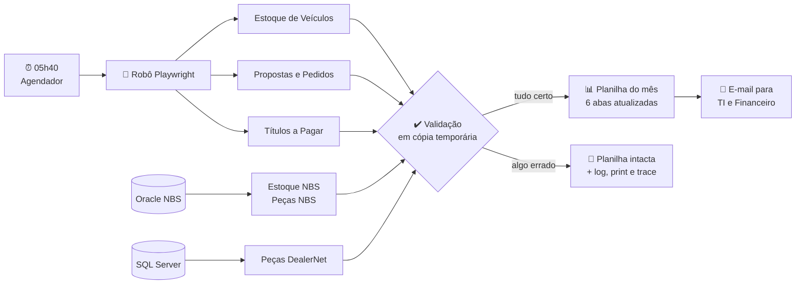

**Feita para nunca estragar a planilha:**
- Toda a atualização acontece numa **cópia temporária**, que só substitui a original depois de recalcular e validar linhas e colunas
- Se um relatório vier vazio ou inválido, se for de outra execução ou se a planilha estiver aberta no Excel, **nada é alterado**
- **Supervisor** encerra a execução após 10 minutos sem progresso e libera uma nova; execuções simultâneas são bloqueadas
- Cópia de segurança local da planilha caso a rede fique indisponível
- Em caso de erro: log, screenshot e trace do Playwright (sem capturar a senha) para diagnóstico rápido
- O e-mail só sai depois que **todas** as etapas terminarem com sucesso
- Testes do supervisor, da recuperação de sessão e dos downloads

`TypeScript` `Node.js` `Playwright` `ExcelJS` `Oracle` `SQL Server` `SMTP` `Agendador de Tarefas`

---

### 🦺 Sistema de Auditorias SSMA · Unipetro

> **Auditorias de Saúde, Segurança e Meio Ambiente saíram do papel para um fluxo digital completo, rastreável e com assinatura.**

<table>
<tr>
<td width="50%">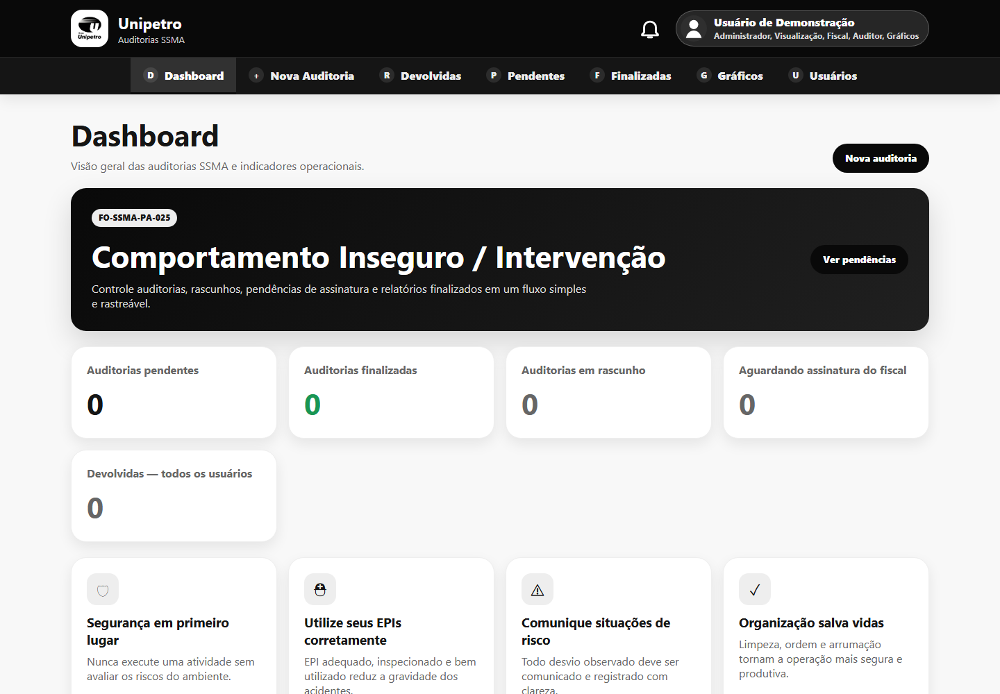</td>
<td width="50%">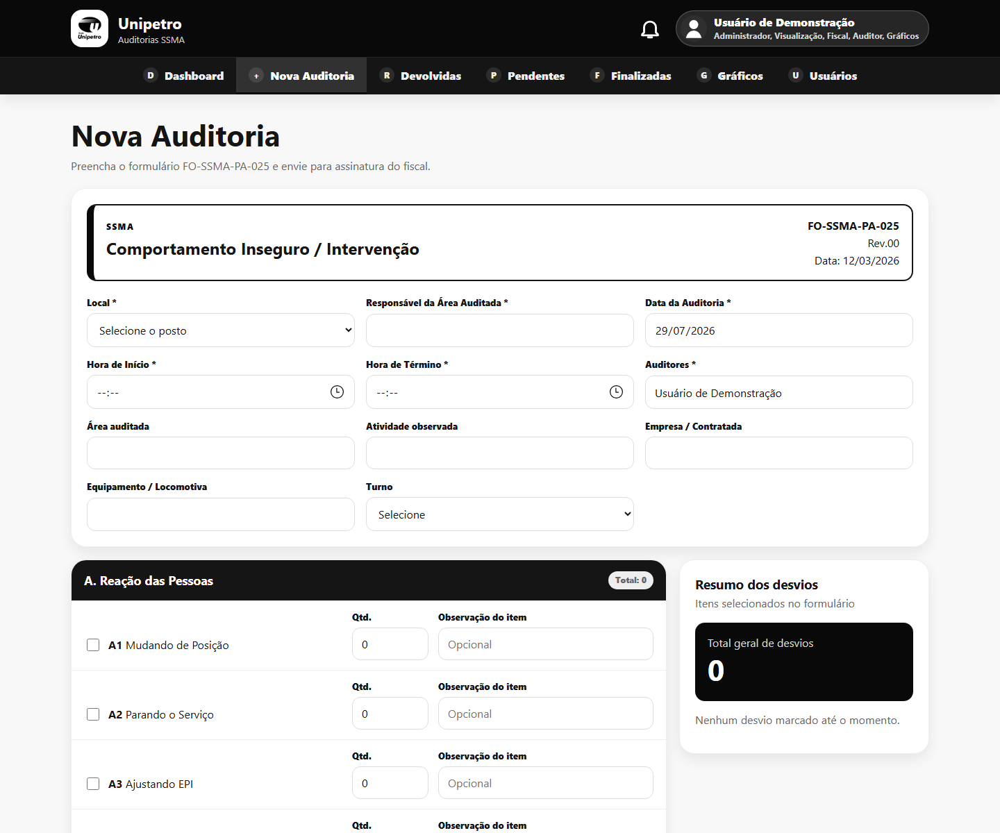</td>
</tr>
<tr>
<td align="center"><b>Dashboard</b></td>
<td align="center"><b>Nova auditoria</b></td>
</tr>
</table>

O formulário **FO-SSMA-PA-025 · Comportamento Inseguro / Intervenção** era preenchido à mão nos postos de operação. Construí do zero um sistema web completo, do frontend ao banco, que digitaliza o processo inteiro:

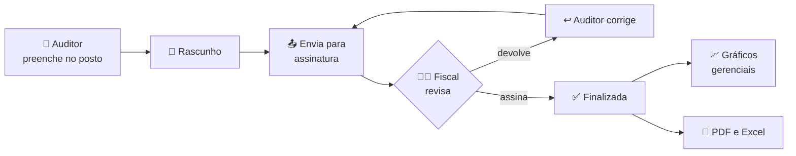

- **Formulário digital** com desvios comportamentais em 6 categorias (A a F), quantidade e observação por item e resumo em tempo real
- **Fluxo de assinatura:** auditor envia, fiscal revisa e assina (assinatura cursiva gerada pelo nome ou desenhada na tela) ou devolve para correção
- **6 perfis de acesso combináveis:** Auditor, Fiscal, Gráficos, Visualização, Criar usuário e Administrador, com as regras aplicadas no backend
- **Gráficos gerenciais** de desvios por classe, posto, auditor, período, turno, área e empresa contratada
- **Relatórios em PDF** e **exportação para Excel** das auditorias finalizadas, com filtros
- Rascunhos, auditorias devolvidas, pendentes e finalizadas, cada uma com sua tela
- Guia do usuário e vídeos de demonstração para o treinamento das equipes
- Publicado como serviço no Windows Server, com o backend servindo o frontend compilado

`React 18` `Vite` `React Router` `Node.js` `Express` `JWT` `SQL Server` `jsPDF`

---

### 💙 Pulse CRM · Central de Leads

> **Um app desktop que enviava leads para uma única loja virou uma plataforma web que atende as 20 lojas e marcas do grupo.**

<table>
<tr>
<td width="50%">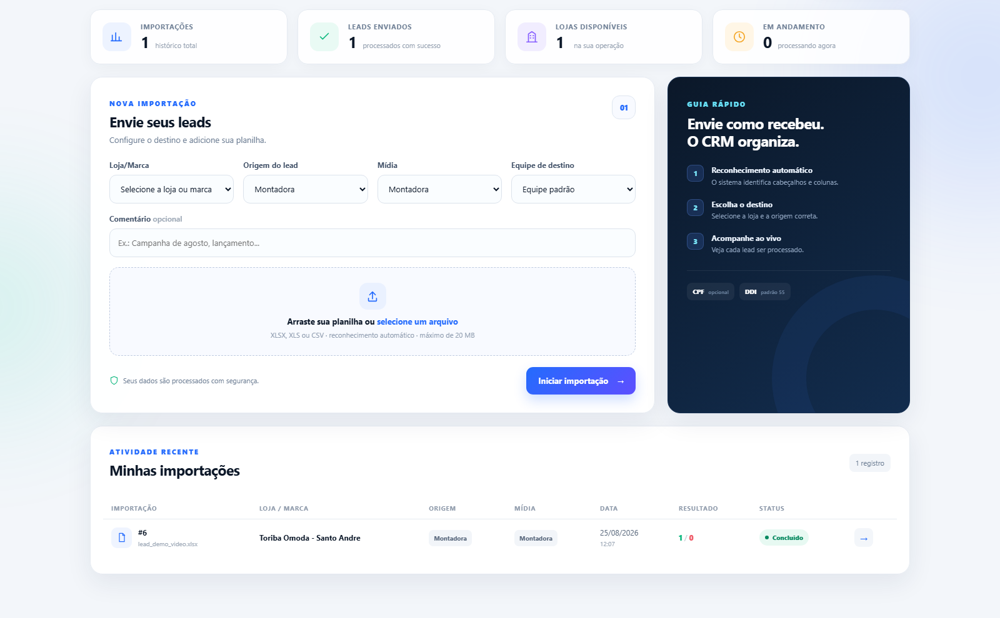</td>
<td width="50%">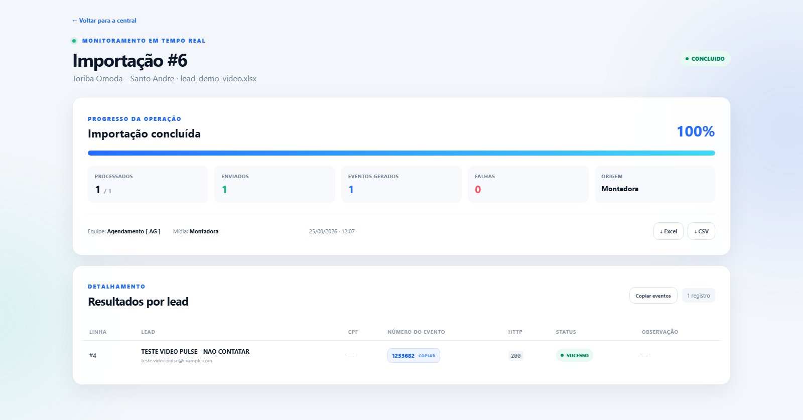</td>
</tr>
<tr>
<td align="center"><b>Central de operação</b></td>
<td align="center"><b>Importação em tempo real</b></td>
</tr>
</table>

Os leads chegam de montadoras e portais como Webmotors, UOL, Mercado Livre e Facebook, cada um numa planilha diferente. Antes, eram enviados ao CRM Syonet por um script desktop fixo em **uma loja**, com a senha da API dentro do código. Reescrevi tudo como uma plataforma web:

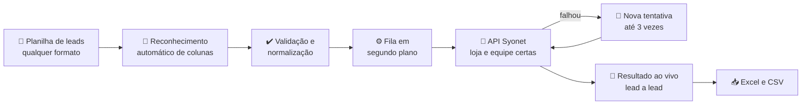

- **Lê planilhas de qualquer formato:** encontra o cabeçalho mesmo com linhas extras antes da tabela, entende nomes alternativos (`Cliente`, `E-mail`, `WhatsApp`, `Veículo de interesse`), identifica colunas pelo conteúdo quando não há cabeçalho e separa DDI e DDD do telefone. Se a estrutura for ambígua, **para e explica o motivo** em vez de mandar dado errado para o CRM
- **Destino escolhido pelo usuário:** loja ou marca, origem, mídia e equipe que vai atender o lead
- **Monitoramento em tempo real:** barra de progresso e resultado de cada lead com número do evento gerado no Syonet, status HTTP e motivo da falha
- **Novas tentativas automáticas** e histórico completo de importações, exportável em Excel e CSV
- **Perfis de acesso:** operadores só veem suas importações e as lojas liberadas para eles; administradores veem e gerenciam tudo
- **Segurança:** credenciais da API fora do código, login individual e recuperação de senha
- Vídeo institucional e demonstração em vídeo para o treinamento das equipes
- Roda como serviço no Windows, com reinício automático se o processo cair

`Django` `Python` `pandas` `API REST` `SQLite` `Waitress` `NSSM`

---

## ⚙️ Outras automações

<table>
<tr>
<td width="50%">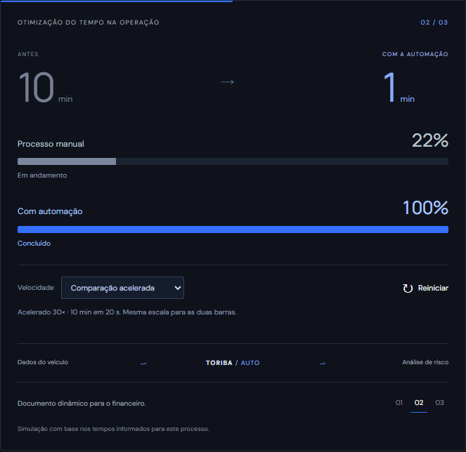</td>
<td width="50%">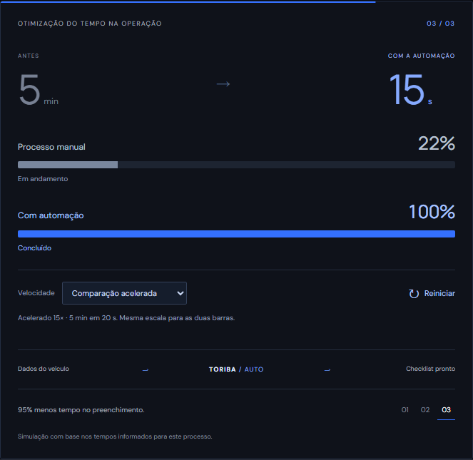</td>
</tr>
<tr>
<td align="center"><b>Análise de Risco · -90%</b></td>
<td align="center"><b>Checklist de Entrega · -95%</b></td>
</tr>
</table>

### 📄 Emissão de Análise de Risco
> **~10 min → ~1 min por veículo faturado.**

O Financeiro precisava de um documento de análise de risco que o ERP NBS não gerava de forma dinâmica. Aplicativo desktop que consulta os dados no ERP e gera o documento pronto a partir de um template Word.

`Python` `Tkinter` `Oracle` `docx` `PyInstaller`

### ✅ Checklist de Entrega de Veículos
> **~5 min → ~15 s por veículo faturado.**

Mesma limitação do NBS, outro documento: o checklist de entrega era preenchido à mão. Agora sai em PDF em segundos, com os dados do sistema.

`Python` `Oracle` `docxtpl` `docx2pdf`

### 🚗 Remoção de Entradas de Frota
> **Mais de 400 veículos por semana.**

Veículos de frota chegam com os arquivos de faturamento da montadora e entram automaticamente no DealerNet, mas precisam ser removidos depois. A automação identifica e exclui essas entradas em lote, com log de cada execução.

`Python` `pandas` `pyodbc` `SQL Server`

### 📬 Relatórios automáticos

| Relatório | Para quem | Frequência |
|---|---|---|
| Faturamento do Pós-venda (Renault e VW) | Integração com o sistema de comércio | Diário |
| Faturamento de Peças (Peugeot e Citroën) | Integração com o sistema de comércio | Diário |
| Limites de Crédito dos clientes | Financeiro | Quinzenal |
| Recebimentos por Proposta de venda | Financeiro | Sob demanda |

Consultam o ERP, consolidam os dados, geram a planilha e enviam por e-mail, sem extração manual.

`Python` `pandas` `SQL Server` `Oracle` `SMTP`

---

## 🖥️ Outras aplicações web

### 🧾 Conciliação Fiscal de NF-e
Busca os XMLs das notas recebidas pelos CNPJs do grupo na API da Qive e compara **item a item** com o lançamento no ERP: CFOP, CST/CSOSN, NCM, bases e alíquotas de ICMS e ICMS-ST, quantidades e valores. As divergências saem em Excel para a equipe fiscal.

- Classificação automática entre notas de **peças, veículos e consumo**, com pareamento de veículos pelo chassi
- Cadastros de DE-PARA de CFOP e CST/CSOSN editáveis pela equipe fiscal
- Relatório consolidado das notas sem entrada no ERP para todas as empresas do grupo
- Serviço no Windows atrás do Nginx, com health check e recuperação automática

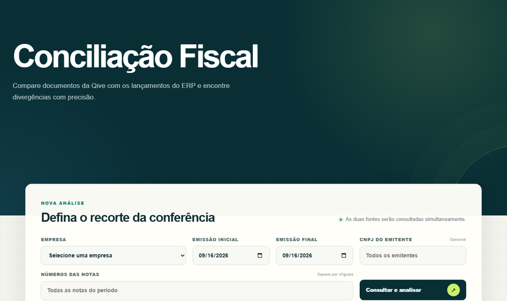

`Node.js` `Express` `SQL Server` `ExcelJS` `fast-xml-parser` `Nginx`

### 📅 Reserva de Salas
Agenda compartilhada das cinco salas da empresa, publicada com HTTPS.

- Reservas recorrentes de até 90 dias com bloqueio de sobreposição no banco
- Senhas com PBKDF2-SHA256, cookies `Secure`/`HttpOnly`/`SameSite=Strict` e limite de tentativas de login
- Exportação para calendário (`.ics`), modo escuro e 13 testes de integração

`Cloudflare D1` `Node.js` `Drizzle`

### ✨ Hub de Projetos
O site da capa deste portfólio: escultura 3D de pontos em Canvas que reage ao scroll e ao ponteiro e comparação animada de tempo de cada processo.

- Desenho em Canvas otimizado de **14,7 ms para cerca de 1,9 ms** por quadro
- Respeita a preferência de movimento reduzido e pausa as animações fora da tela

`HTML` `CSS` `JavaScript` `Canvas`

---

## 🛠️ Infraestrutura e operação

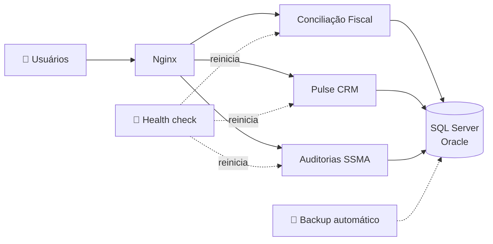

- Aplicações publicadas no Windows Server como serviços (NSSM e Agendador de Tarefas), atrás do Nginx
- Health check com recuperação automática, painel de operação e scripts de validação
- Backup automatizado dos bancos e segredos centralizados fora do código-fonte
- Documentação técnica e manual de cada sistema

---

Sistemas desenvolvidos para uso interno. O código-fonte e os dados pertencem às empresas e não são públicos.

📫 **gabrielsaraivabr@gmail.com**

